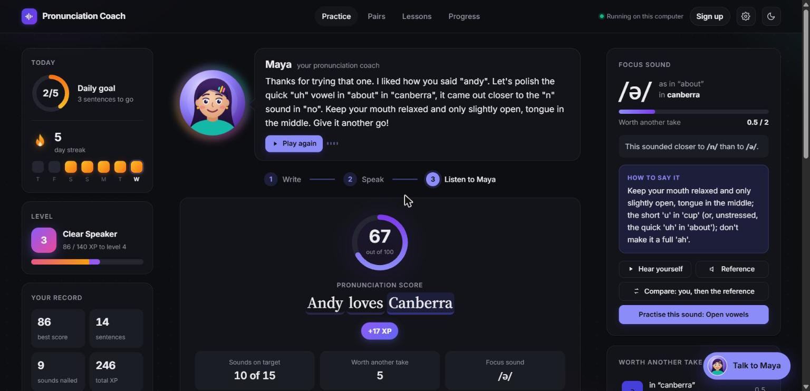
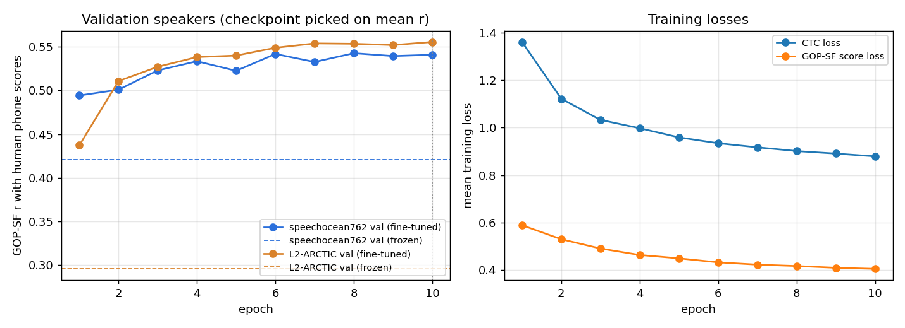
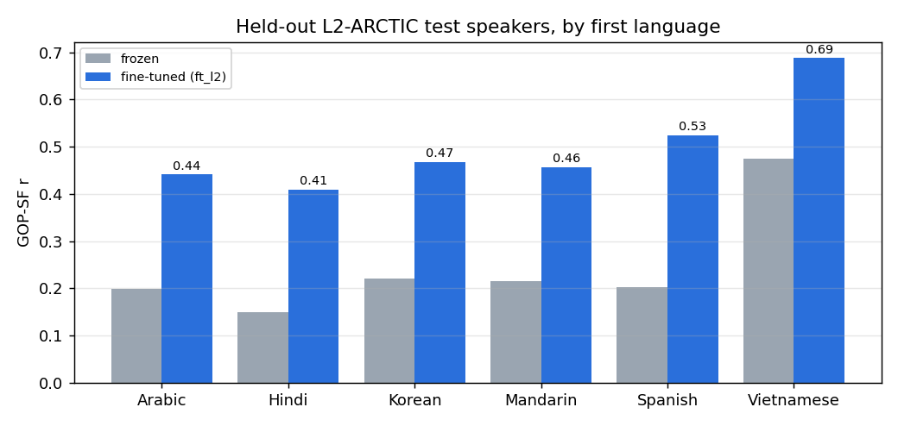
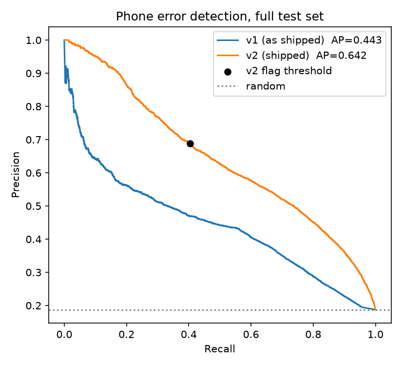
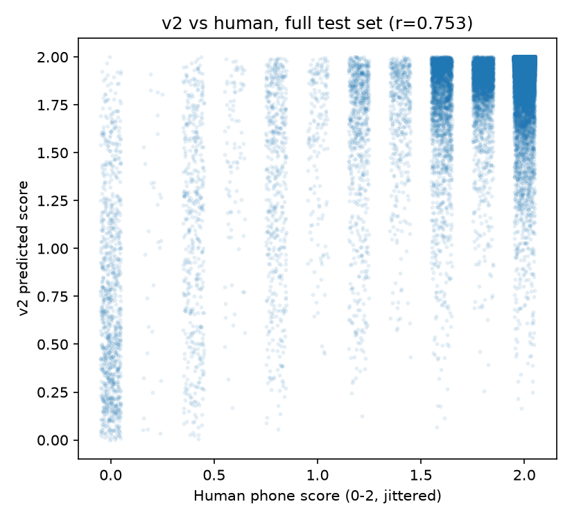

# Pronunciation Coach

**Say a sentence. Get a score for every sound you made, hear what to fix,
and keep coming back.**

Pronunciation Coach scores English pronunciation phoneme by phoneme with a
wav2vec2 acoustic model. Maya, an illustrated voice coach, then talks you
through the result. It runs on your own computer, or hosted with accounts
so your progress follows you.

**Try it live:** https://notjustaroaster--pronunciation-coach-web.us-east.modal.run
(the first visit after a quiet spell takes about 30 s while the server wakes up).



- **Measured, not guessed.** Scores come from the acoustic model's own
  phone-level evidence (GOP-SF), checked against expert raters on speakers
  it never saw: **r = 0.80** with the hosted model. No LLM ever scores
  anything.
- **Built for different accents.** It was fine-tuned on learners with six first
  languages, and lessons, minimal pairs and tips are tuned to the language you speak.
- **A coach you want to come back to.** Maya reacts to what you do, and XP,
  levels, streaks and a daily goal turn practice into a habit.
- **Honest evaluation.** Train and test use different speakers, every choice
  was made on training or validation data, and each test split was scored
  once. See [`REPORT_v2.md`](REPORT_v2.md) and
  [`docs/FINETUNING.md`](docs/FINETUNING.md).

## What you get

**The practice loop**
1. **Write.** Type any sentence or pick a suggestion (picked for your first
   language). *Hear it first* reads it aloud.
2. **Speak.** Tap the mic (or press **Space**), read it, tap again. You can
   also upload a file or use a sample recording.
3. **Listen.** You get a 0–100 score, a colour-coded tile for every sound
   (0–2), fluency and rhythm scores (0–10), and what each sound was heard as.
   Maya reads her feedback aloud. Click a sound for a tip and a reference, or
   a word to hear yourself say it.

**Maya, your coach.** An illustrated character, not a stock avatar. She
blinks and follows your pointer. While you record she tilts her head to listen,
and her halo pulses with your voice. While scoring she looks thoughtful. She
lip-syncs while speaking and beams at a great score. Her words only rephrase the
measured scores and the hand-written tips. With free Groq, Gemini or Mistral
keys a small LLM does the rephrasing; without keys she uses a built-in
template. You can also ask her questions, typed or spoken ("how do I say th?").

**Tuned to your first language.** After sign-up (or as a guest) you pick
your first language. The app then:
- ranks the sounds to focus on;
- recommends lessons and minimal pairs, and suggests sentences;
- adds a short note to flagged sounds.

For Arabic, Mandarin, Hindi/Urdu, Korean, Spanish and Vietnamese the focus
sounds come from what speakers of that language were actually marked wrong on
in L2-ARCTIC. German, French, Japanese, Portuguese and Russian use commonly
described patterns and are labelled as such.

**Momentum and rewards:**
- **Levels:** XP and 11 named levels, from "Warm-up" to "Legend".
- **Daily goal:** a ring that fills at five sentences a day.
- **Streaks:** a streak flame with a 7-day strip.
- **Reward chips:** for personal bests, flawless takes, streak days and finished goals.
- **Big moments:** confetti, chimes and a level-up card.

All of it can be switched off in Settings, and motion follows your device's
reduced-motion setting. XP is derived from your practice history, so it syncs
with your account.

**More:**
- **Minimal-pair drills** (ship / sheep, think / sink, …).
- **Lessons:** short courses on the hardest sounds.
- **Progress page:** per-sound trend lines.
- **A/B playback:** compare yourself with a reference voice.
- **Strictness levels.**
- **Installable:** as a PWA or an Android app (APK in
  [Releases](https://github.com/Victus0904/phoneme-mispronunciation-detection/releases/latest),
  see [`android/README.md`](android/README.md)).

**Layout.** On wide screens the page has three zones: your momentum on the
left, the task in the centre, and coaching detail on the right. On tablets the
left zone folds into a strip, and on phones everything stacks with a bottom
tab bar.

## Results

All numbers are on speakers the model never trained on.
[speechocean762](https://huggingface.co/datasets/mispeech/speechocean762)
test: 2,500 utterances, 47,369 phones, each scored 0–2 by expert raters.

| | v1 | v2, frozen model (local default) | **v2, fine-tuned `ft_l2` (hosted)** |
|---|---|---|---|
| Correlation with human phone scores (Pearson r) | 0.448 | 0.753 | **0.798** |
| Error detection (average precision) | 0.443 | 0.642 | **0.672** |
| Real errors flagged at Standard (recall) | 10% | 40% | **54%** |
| Flags that are real errors at Standard (precision) | 63% | 69% | **65%** |
| Six other first languages, L2-ARCTIC held-out speakers (GOP-SF r) | – | 0.286 | **0.530** |
| Fluency / rhythm (0–10), test r | – | 0.82 / 0.81 | 0.83 / 0.82 |

v1 is the original recipe re-run on the full test split. The fine-tuned
model retrains the top 8 of 24 transformer layers on speechocean762 +
[L2-ARCTIC](https://psi.engr.tamu.edu/l2-arctic-corpus/) and is
**non-commercial** (CC BY-NC 4.0, inherited from L2-ARCTIC).

<p>
  
  
</p>
<p>
  
  
</p>

### Strictness levels

Thresholds were chosen on training-split predictions only, then checked once
on test speakers (18.7% of test sounds are rated below 2 by the experts).
Each cell is recall / precision / share of sounds flagged.

| Level | Frozen model | Fine-tuned model (hosted) |
|---|---|---|
| Relaxed | 27% / 79% / 6% | 36% / 77% / 9% |
| Standard (default) | 40% / 69% / 11% | 54% / 65% / 16% |
| Strict | 68% / 53% / 24% | 69% / 56% / 23% |
| Very strict | 84% / 42% / 38% | 85% / 43% / 37% |

The overall score is the share of sounds on target at your level, so it drops
as you make the coach stricter.

## Quick start (local)

You need Python (tested on 3.13) and **espeak-ng** (the model's tokenizer
needs it at load time): `winget install eSpeak-NG.eSpeak-NG` on Windows,
`apt install espeak-ng` on Linux.

```
pip install -r requirements.txt
python server.py          # or double-click run_app.bat (Windows) / ./run_app.sh
```

Your browser opens at http://127.0.0.1:7860. The first run downloads the
acoustic model (~1.2 GB). The trained heads are in `models/`, so no training
is needed. Locally the app uses the frozen model. To use a fine-tuned one,
see [Configuration](#configuration).

To share your local copy for free, run `run_public.bat`; it prints a
temporary `https://….trycloudflare.com` link.

## Hosting

- **Modal** (what the live site uses): `modal deploy scripts/modal_web.py`.
  - **Runtime:** CPU-only, 2 cores / 6 GiB, scales to zero 5 minutes after the
    last request (about $0.15 per running hour, nothing while idle).
  - **Model:** serves the fine-tuned model from the `pmd-ft` volume.
  - **Accounts:** stored on the `pmd-accounts` volume.
  - **Session key:** the Modal Secret `pmd-session`.
  - **Rollback:** `WEB_MODEL=frozen` deploys the frozen model instead.
- **Fine-tuning on Modal GPUs:** `scripts/modal_app.py`, with a spend guard
  (`scripts/modal_budget.py`). See [`docs/FINETUNING.md`](docs/FINETUNING.md).
- **Other targets:**
  - Hugging Face Space: `deploy/space/`, `scripts/deploy_space.py`.
  - Google Cloud Run: `scripts/deploy_cloudrun.py`.
  - AWS App Runner: [`DEPLOY.md`](DEPLOY.md).

## Accounts, data and privacy

| What | Where |
|---|---|
| Recordings | **Never stored.** Decoded in memory, scored, discarded. |
| Account: email, name, first language, scrypt password hash | Hosted: one JSON file per user (named by a hash of the email) on the Modal Volume `pmd-accounts`. Local: `data/accounts.json`. |
| Practice history (sentences, scores, per-sound averages) and pair tallies | Your browser (`localStorage`); also synced to your account when signed in. |
| Login | A signed (HMAC-SHA256), HttpOnly, SameSite=Lax cookie, valid 30 days. |
| Recent results for the coach | Server memory only (last 300, no audio); gone when the container stops. |
| LLM coach (optional) | With keys, your sentence and scores (never audio) go to Groq, Gemini or Mistral; spoken questions are transcribed by Groq. Off on the hosted site. |

Guests can practise without an account; their progress stays in that
browser. On sign-up a guest's history moves into the account. Logging out
clears it from that browser, and deleting the account deletes everything.

## How it works

```
audio ──► wav2vec2 (frozen, or top 8 layers fine-tuned) ──► phone posteriors + hidden states
                                   │
target sentence ──► g2p ──► expected phones
                                   │
                                   ▼
          CTC forced alignment  +  alignment-free GOP (GOP-SF)
                                   │
                                   ▼
     per-phone features: GOP, substitution/deletion likelihoods,
     phone identity, context, pooled layer-16 representation
                                   │
                                   ▼
        GBM + small transformer ensemble ──► 0–2 score per sound
                                   │
                                   ▼
   strictness thresholds ──► flags ──► hand-written tips ──► Maya (template or LLM rephrasing)
```

The key idea is **GOP-SF**. This acoustic model is "peaky": most phones get
a single 20 ms frame in a forced alignment, and v1 judged each sound from that
one frame. GOP-SF instead compares how likely the model finds the whole
expected sentence against the same sentence with one phone swapped for each
alternative, or deleted. That needs no alignment, and it also says *which*
sound you produced instead.

The **fine-tune** trains on two losses together:
- CTC on what each speaker actually said, with the annotated mispronunciations applied;
- a differentiable GOP-SF loss regressed onto the expert phone scores.

The first keeps the model an honest phone recognizer; the second sharpens
exactly the evidence the scorer uses. Details, ablations and per-phone results
are in [`REPORT_v2.md`](REPORT_v2.md) and [`docs/FINETUNING.md`](docs/FINETUNING.md).

**App stack:**
- **Front end:** `web/index.html`, a single-file PWA with no build step; audio
  is decoded and resampled in the browser.
- **Back end:** FastAPI (`server.py`), with per-IP rate limits on scoring,
  auth and sync.
- **Tests:** `tests/` covers scoring at every strictness level, input
  validation, accounts, sessions and progress sync.

## Configuration

| Variable | Default | Purpose |
|---|---|---|
| `ACOUSTIC_MODEL` | `facebook/wav2vec2-lv-60-espeak-cv-ft` | Acoustic model (Hub id or local folder, e.g. a fine-tuned `runs/ft_l2/best`) |
| `MODELS_DIR` | `models/` | Folder of heads matched to that model (`head_v2.joblib`, `utt_v2.joblib`, `strictness.json`, `pairs_calibration.json`, optional `model_card.json`) |
| `ACCOUNTS_STORE` | `data/accounts.json` | `<path>.json`, `dir:<folder>`, or `modal-volume:<name>:<mount>` |
| `SESSION_SECRET` | random, saved to `data/session_secret` | Key that signs login cookies (set it when hosting) |
| `HOSTED` | unset | `1` makes the page say audio is sent to the server, and marks cookies Secure |
| `GROQ_API_KEY`, `GEMINI_API_KEY`, `MISTRAL_API_KEY` | unset | Optional free-tier keys for Maya's wording and voice (see `.env.example`) |
| `TEACHER_NAME` | `Maya` | The coach's name |
| `HOST`, `PORT` | `127.0.0.1`, `7860` | Where the local server listens |

## Limitations

- **Accents:** the default model is trained and evaluated only on Mandarin-L1
  learners, mostly children. The fine-tuned model was also checked on one
  held-out speaker each of six first languages (r 0.41–0.69); other first
  languages haven't been measured.
- **False alarms:** scores are a practice signal, not a verdict. At Standard
  about 1 in 3 flags is a false alarm. V, UW, L, TH and DH are the hardest
  sounds for the model.
- **Fine-tuned weights:** they aren't published (1.3 GB, non-commercial).
  Reproduce them with `scripts/finetune_acoustic.py`.
- **Minimal pairs:** accuracy (80–82% right, 6–7% wrong) was measured on
  synthetic Windows voices, not real learners.
- **Sentence-to-phones step:** `g2p_en` hasn't been evaluated, so avoid
  numerals and unusual words.
- **Accounts are prototype-grade:** no email verification, password reset or
  admin tools yet.

## Repository layout

```
server.py                 FastAPI app: scoring, coach, accounts, progress sync
web/index.html            single-file front end (PWA): practice, pairs, lessons, progress
web/sw.js, manifest       offline shell + install
models/                   trained heads for the frozen model, strictness, pair calibration,
                          l1_stats.json (per-first-language error rates from L2-ARCTIC)
src/
  acoustic.py             acoustic model (ACOUSTIC_MODEL), posteriors, silence trimming
  align.py                CTC forced alignment
  features_v2.py          GOP-SF, GOPT-style vectors, context, embeddings
  head_v2.py              GBM + transformer scoring heads
  scorer.py               inference with word/phone timestamps (MODELS_DIR)
  utterance_v2.py         fluency / rhythm heads
  text.py, phone_mapping.py   sentence -> phones, ARPAbet <-> IPA
  tips.py, pairs.py       hand-written tips, minimal-pair sets
  teacher.py              Maya: LLM / TTS / Whisper chain with template fallback
  accounts.py             sign-up, scrypt, signed sessions, pluggable stores, progress
  l1_profiles.py          first-language focus sounds, lessons, notes
  features.py, train_head.py, data.py   v1 pipeline and dataset loading
scripts/
  extract_full.py ... train_v2.py, calibrate_strictness.py, train_fluency.py   v2 pipeline
  finetune_acoustic.py, l2arctic.py, eval_accents.py, finetune_report.py       fine-tuning
  build_l1_stats.py, synth_pairs.ps1, check_pairs.py, fit_pairs_calibration.py
  modal_app.py, modal_web.py, modal_budget.py   Modal GPU jobs, hosting, spend guard
  deploy_space.py, deploy_cloudrun.py, build_and_push.sh   other hosting targets
tests/                    end-to-end tests (python -m unittest discover tests)
android/                  Android app (WebView shell) and its build script
deploy/space/             Hugging Face Space Dockerfile
docs/FINETUNING.md        fine-tuning method, results, costs
REPORT.md, REPORT_v2.md   v1 and v2 evaluation write-ups
app.py                    original v1 Gradio demo
```

## Reproducing the results

The dataset is expected at
`datasets/speechocean762/data/{train,test}-00000-of-00001.parquet`
(the Hugging Face parquet export). Training and evaluation also need a
"shared" FFmpeg build for `torchcodec` (`winget install Gyan.FFmpeg.Shared`
on Windows). The app itself decodes audio in the browser and doesn't need
FFmpeg.

```
python scripts/extract_full.py        # model pass over all 5,000 utterances (~75 min CPU, ~8 GB cache)
python scripts/build_features_v2.py   # feature table (~6 min)
python scripts/cv_v2.py gbm_vec_h16 seq_vec_h16_s0 seq_vec_h16_s1   # train-split CV
python scripts/train_v2.py            # final fit, one-time test evaluation, models/ + figures/
python scripts/calibrate_strictness.py   # strictness thresholds (train OOF) + their test numbers
python scripts/build_utt_features.py && python scripts/train_fluency.py   # fluency + rhythm heads
```

Fine-tuning (about an hour on one A10G, under $3 on Modal for everything)
and the L2-ARCTIC loader are in [`docs/FINETUNING.md`](docs/FINETUNING.md).

To check the app after a change, run `python -m unittest discover tests`
(about a minute on CPU; no LLM calls). Everything is seeded. The v1 pipeline
is still runnable; see [`REPORT.md`](REPORT.md).

## Anti-goals

No accent classifier, no accent conversion, no
Whisper-transcript-as-pronunciation-score, no LLM-generated scores. Whisper
only transcribes the questions you ask Maya; it never judges your
pronunciation. ASR is built to recover the intended words *despite*
mispronunciation, which is exactly the signal a pronunciation scorer must not
throw away (see [`REPORT.md`](REPORT.md) Section 1).

## Data licences

L2-ARCTIC is CC BY-NC 4.0, so the fine-tuned model and anything derived from
L2-ARCTIC (including `models/l1_stats.json`) are for **non-commercial use
only**. Check speechocean762's own licence on its dataset page before reusing
it. The repository doesn't include a licence file for the code yet.
