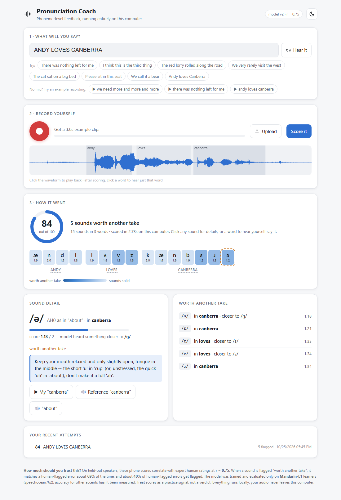
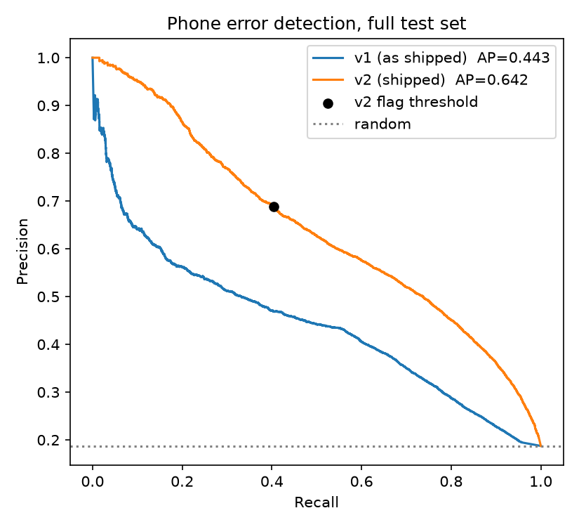
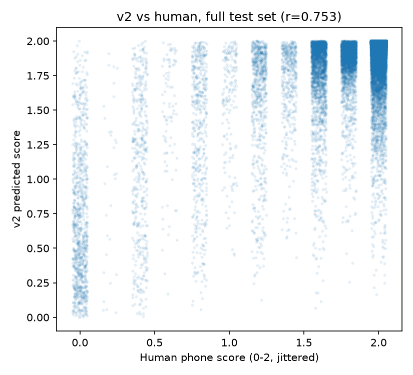

# Pronunciation Coach

**Phoneme-level pronunciation feedback that runs entirely on your own computer.**
Read a sentence aloud and get a score for every sound you made, the sounds
worth another take, what the model heard instead, and a tip for fixing each
one.



- **Frozen acoustic model, no fine-tuning.** It uses
  `facebook/wav2vec2-lv-60-espeak-cv-ft` as-is. Only a small scoring head
  is trained.
- **No LLM anywhere.** Scores come from the acoustic model's own
  phone-level evidence. Coaching tips are a hand-written table, because a
  wrong generated articulation instruction is worse than a correct generic
  one.
- **Honest evaluation.** Train and test use different speakers, every
  choice was made on the train split, and the test split was scored once.
  See [`REPORT_v2.md`](REPORT_v2.md).

## Results

Evaluated on [speechocean762](https://huggingface.co/datasets/mispeech/speechocean762),
whose test speakers never appear in training. The test split has 2,500
utterances and 47,369 phones, each scored 0–2 by expert raters.

| | v1 | **v2 (current)** |
|---|---|---|
| Correlation with human phone scores (Pearson r) | 0.448 | **0.753** |
| Error detection (average precision) | 0.443 | **0.642** |
| Flagged sounds that are real errors (precision) | 0.63 | **0.69** |
| Real errors that get flagged (recall) | 0.10 | **0.40** |
| CPU speed | 3.9× real time | **5.9× real time** |

The v1 column is v1's recipe re-run on the same full test split. On the
500-utterance subset v1 originally reported on, r goes from 0.431 to 0.719.

<p>
  
  
</p>

## Quick start

You need Python (tested on 3.13) and **espeak-ng** (the model's tokenizer needs it at
load time). On Windows, install it with `winget install eSpeak-NG.eSpeak-NG`;
on Linux, `apt install espeak-ng`.

```
pip install -r requirements.txt
python server.py          # or double-click run_app.bat (Windows) / ./run_app.sh
```

Your browser opens at http://127.0.0.1:7860. The first run downloads the
acoustic model (~1.2 GB). The trained scoring head is already in the repo
(`models/head_v2.joblib`), so no training is needed.

Then:

1. Type a sentence or pick one of the suggestions. **Hear it** reads it
   aloud with your system voice.
2. Press the red button (or **Space**), read the sentence, and press again
   to stop. You can also upload a file or try an example recording.
3. Click any sound for details and a tip, or click a word to hear just that
   word from your recording.

Audio never leaves your machine. Your recent attempts are saved in your
browser only.

## How it works

```
audio ──► frozen wav2vec2 ──► phone posteriors + hidden states
                                   │
target sentence ──► g2p ──► expected phones
                                   │
                                   ▼
          CTC forced alignment  +  alignment-free GOP (GOP-SF)
                                   │
                                   ▼
     per-phone features: GOP, substitution/deletion likelihoods,
     phone identity, context, pooled layer-16 representation
                                   │
                                   ▼
        GBM + small transformer ensemble ──► 0–2 score per sound
```

The biggest improvement over v1 is **GOP-SF**. This acoustic model is
"peaky": most phones get a single 20 ms frame in a forced alignment, and v1
judged each sound from that one frame. GOP-SF instead compares how likely
the model finds the whole expected sentence against the same sentence with
one phone swapped for each alternative, or deleted. That comparison needs
no alignment at all, and it also says *which* sound you produced instead.
The full story, ablations and per-phone results are in
[`REPORT_v2.md`](REPORT_v2.md).

## Limitations

- **Trained and evaluated only on Mandarin-L1 English learners**, mostly
  children. Accuracy for other accents hasn't been measured.
- Scores are a practice signal, not a verdict. About 3 in 10 flags are
  false alarms. V, UW, L, TH and DH are the hardest sounds for the model.
- The sentence-to-phones step (`g2p_en`) hasn't been evaluated. Avoid
  numerals and unusual words.

## Repository layout

```
server.py, web/index.html   local app (FastAPI backend + single-file front end)
run_app.bat, run_app.sh     launchers
models/head_v2.joblib       trained v2 scoring head
src/
  acoustic.py      frozen model, posteriors, silence trimming
  align.py         CTC forced alignment
  phone_mapping.py ARPAbet <-> IPA mapping (built empirically, see REPORT.md 2.1)
  features_v2.py   v2 features (GOP-SF, GOPT-style vectors, context, embeddings)
  head_v2.py       v2 heads: GBM, transformer, ensemble
  scorer.py        inference with word/phone timestamps
  text.py          sentence -> phones (g2p_en)
  tips.py          hand-written coaching tips for every phone
  features.py, train_head.py, data.py   v1 pipeline and dataset loading
scripts/           v2 extraction, feature building, CV, final training
app.py             original v1 Gradio demo
REPORT.md          v1 evaluation write-up
REPORT_v2.md       v2 changes, evaluation and reproduction steps
```

## Reproducing the results

The dataset is expected at
`datasets/speechocean762/data/{train,test}-00000-of-00001.parquet`
(the Hugging Face parquet export). Training and evaluation also need a
"shared" FFmpeg build for `torchcodec`; on Windows that's `winget install
Gyan.FFmpeg.Shared`. The app itself decodes audio in the browser and
doesn't need FFmpeg.

```
python scripts/extract_full.py        # frozen-model pass over all 5,000 utterances (~75 min CPU, ~8 GB cache)
python scripts/build_features_v2.py   # feature table (~6 min)
python scripts/cv_v2.py gbm_vec_h16 seq_vec_h16_s0 seq_vec_h16_s1   # train-split CV
python scripts/train_v2.py            # final fit, one-time test evaluation, models/ + figures/
```

Everything is seeded. The v1 pipeline is still runnable; see
[`REPORT.md`](REPORT.md) and `python src/train_head.py`.

## Anti-goals

No accent classifier, no accent conversion, no
Whisper-transcript-as-pronunciation-score, no chatbot, no speaker
adaptation, no prosody scoring. ASR is built to recover the intended words
*despite* mispronunciation, which is exactly the signal a pronunciation
scorer needs (see [`REPORT.md`](REPORT.md) Section 1).
